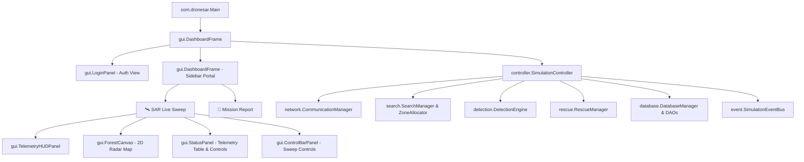

# Drone-SAR-sim: Autonomous Tactical UAV Fleet Management System

> **Simulation-based Drone Fleet Management System for Search and Rescue (SAR) Operations in Forest Terrain**  
> Developed in **Java 21** using **Swing** and **Maven**, following strict Object-Oriented Programming (OOP) paradigms and the **Model-View-Controller (MVC)** architectural pattern.

---

## 🚁 Key Features & UI Workflow

```
   ┌────────────────────────────────────────────────────────┐
   │                  1. LOGIN SCREEN                       │
   │  • Displays Project Name & Tactical Badge              │
   │  • Standalone: Zero external backend required          │
   │  • Pre-filled Demo Access: commander / sar2026         │
   └───────────────────────────┬────────────────────────────┘
                               │ (Click "ACCESS COMMAND CENTER")
                               ▼
   ┌────────────────────────────────────────────────────────┐
   │            2. COMMAND CENTER (SIDEBAR NAV)             │
   │ ┌──────────────────────┬─────────────────────────────┐ │
   │ │  SIDEBAR MENU:       │  ACTIVE VIEW (CENTER):      │ │
   │ │  • 🛰️ SAR Live Sweep │  • Radar Map & Live Drones  │ │
   │ │  • 📄 Mission Report │  • Incident & Recovery Log  │ │
   │ │  • 🚪 Log Out        │                             │ │
   │ └──────────────────────┴─────────────────────────────┘ │
   └────────────────────────────────────────────────────────┘
```

1. **Simple Standalone Login Screen ([LoginPanel.java](file:///Users/saviosanil/OOP%20project/drone-management-system/src/main/java/com/dronesar/gui/LoginPanel.java))**:
   - Clean dark-themed tactical login card.
   - Project branding: **AERO-SAR PORTAL - Drone SAR Fleet Operations Command**.
   - Standalone authentication with zero external backend or database setup needed.
   - Demo credentials pre-filled: Username: `commander` | Password: `sar2026`.
2. **Streamlined Dashboard with 2 Core Navigation Options ([DashboardFrame.java](file:///Users/saviosanil/OOP%20project/drone-management-system/src/main/java/com/dronesar/gui/DashboardFrame.java))**:
   - **Menu Option 1: `🛰️ SAR Live Sweep`**:
     - The active 60-FPS drone simulation with rotating radar beam, drone quadrant sweep patterns, dual base towers, and manual drone controls.
     - Live bottom bar displaying real-time geographic GPS coordinates (e.g. `45.3910° N, 121.8103° W`) when a survivor is discovered.
     - Bottom-right Located Survivors registry table (slimmed sidebar leaving the map wide and unobstructed).
   - **Menu Option 2: `📄 Mission Report` ([MissionReportPanel.java](file:///Users/saviosanil/OOP%20project/drone-management-system/src/main/java/com/dronesar/gui/MissionReportPanel.java))**:
     - Executive incident report with live KPI cards: Survivors Recovered, Area Swept %, Mission Duration, and UAV Fleet Readiness.
     - Detailed Survivor Casualty Recovery Log with exact real-world GPS coordinates, discovering UAV, and relay station.
     - Autonomous UAV Swarm Flight & Battery Telemetry log.
     - Action buttons to **Refresh Report** and **Export Summary**.
   - **Operator Badge & Logout**: Shows logged-in user and provides a 1-click `🚪 Log Out` button returning to the login screen.

---

## 🏛️ System Architecture (MVC Pattern)



---

## 👥 Module Allocation & Team Integration

All core subsystems have been developed and integrated across the project packages:

| Module / Package | Key Classes | Description & OOP Concepts |
| :--- | :--- | :--- |
| **GUI & Visualization** (`com.dronesar.gui`) | `DashboardFrame`, `LoginPanel`, `ForestCanvas`, `TelemetryHUDPanel`, `StatusPanel`, `MissionReportPanel`, `ControlBarPanel`, `Theme` | **View Layer**: Standalone login, 2-item sidebar navigation, 60-FPS tactical radar canvas, executive report page. |
| **Controller & Coordination** (`com.dronesar.controller`) | `SimulationController` | **Controller Layer**: Central orchestrator coordinating drone ticks, mission duration, and event dispatches. |
| **Fleet & Spatial Models** (`com.dronesar.model`) | `Drone`, `Position`, `SearchZone`, `Tower`, `PersonNode`, `TransmissionSignal`, `RescueTeam`, `Message` | **Model Layer**: Encapsulation of drone physics, battery depletion, geographic GPS conversion, and dual tower locations. |
| **Search & Waypoint Planning** (`com.dronesar.search`) | `SearchPattern`, `ZoneAllocator`, `SearchManager` | **Strategy Pattern**: Grid partitioning and Boustrophedon sweep route planning. |
| **Sensors & Detection** (`com.dronesar.detection`) | `DetectionEngine`, `LocalizationEngine`, `SignalsSimulator` | **Sensor Modeling**: Thermal/optical sensor sweep, RF signal path loss attenuation, and target localization. |
| **Communications & Mesh** (`com.dronesar.network`) | `CommunicationManager`, `NetworkNode` | **Networking**: Dual base direct RF comms, packet delivery verification, offline retry buffers. |
| **Rescue Operations** (`com.dronesar.rescue`) | `RescueManager`, `RescueTeam` | **Operations**: Autonomous dispatch of ground emergency units upon survivor detection. |
| **Blackbox Persistence** (`com.dronesar.database`) | `DatabaseManager`, `DetectionDAO`, `MissionDAO` | **Singleton & DAO Patterns**: Thread-safe detection incident logging and historical mission tracking. |
| **Event Bus** (`com.dronesar.event`) | `SimulationEventBus`, `SimulationEventListener` | **Observer Pattern**: Decoupled asynchronous event broadcasting for target detections and status updates. |

---

## 🚀 How to Run and Test

In your terminal from `drone-management-system`:

```bash
# 1. Run all unit and integration tests
mvn test

# 2. Launch the application
mvn compile exec:java
```